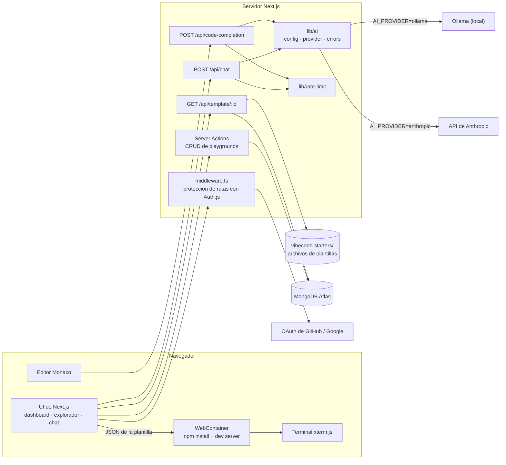

# VibeCode Editor

[English](README.md) · **Español**


Un IDE web que ejecuta proyectos completos **dentro del navegador**. Eliges una plantilla (React, Next.js, Express, Vue, Hono o Angular), la editas en Monaco, la ejecutas con WebContainers, usas la terminal integrada y tienes ayuda de un asistente de IA y de autocompletado de código.

El proveedor de IA es configurable: **Ollama** en local (gratis, sin API key) o la **API de Anthropic** (Claude) en producción.

## Funcionalidades

- **Login con OAuth** de GitHub y Google (Auth.js + adaptador de Prisma).
- **Dashboard** para crear, renombrar, duplicar, borrar y marcar como favoritos los playgrounds.
- **6 plantillas**: React, Next.js, Express, Vue, Hono y Angular.
- **Explorador de archivos**: crear, renombrar y borrar archivos y carpetas; los cambios se guardan en MongoDB.
- **Editor Monaco** con resaltado por lenguaje y `Ctrl+S` para guardar.
- **Ejecución en el navegador** con WebContainers: `npm install` y el servidor de desarrollo corren en la pestaña, con vista previa en vivo.
- **Terminal** (xterm.js) conectada al WebContainer.
- **Chat de IA** con modos chat / review / fix / optimize y renderizado de Markdown y código.
- **Autocompletado con IA**: `Ctrl+Space` (o tras escribir caracteres como `{`, `.`, `=` o un salto de línea); `Tab` acepta y `Esc` descarta.
- Tema claro/oscuro.

## Stack

| Capa | Tecnología |
|---|---|
| Framework | Next.js 15 (App Router, Server Actions, Route Handlers), React 19, TypeScript |
| UI | Tailwind CSS 4, shadcn/ui (Radix), lucide-react |
| Autenticación | Auth.js (NextAuth v5) — OAuth de GitHub y Google, sesiones JWT |
| Base de datos | MongoDB Atlas + Prisma ORM |
| Editor | Monaco Editor (`@monaco-editor/react`) |
| Runtime | WebContainers (`@webcontainer/api`) |
| Terminal | xterm.js |
| IA | Ollama (local) o API de Anthropic con `@anthropic-ai/sdk` |
| Calidad | ESLint, `tsc`, Vitest, GitHub Actions |

## Arquitectura



**Cómo se ejecuta un playground**

1. El usuario crea un playground y elige una plantilla. Sus datos se guardan en MongoDB.
2. La primera vez que se abre, `/api/template/[id]` lee la carpeta de la plantilla en `vibecode-starters/` y la devuelve como JSON. Después se usan los archivos guardados en MongoDB.
3. El navegador monta esos archivos en un WebContainer, ejecuta `npm install` y arranca el servidor de desarrollo (script `dev`, `start` o `serve`). La vista previa es un iframe que apunta a ese servidor.
4. Cada guardado actualiza el sistema de archivos del WebContainer y MongoDB.

**Las peticiones de IA** pasan por `lib/ai`: `getAIConfig()` lee el entorno, `generateText()` llama a Ollama (`/api/chat`) o a la Messages API de Anthropic, y `classifyAIError()` convierte los fallos en errores HTTP claros (429, 503, 504…). Las dos rutas de IA exigen sesión, validan el tamaño de la entrada, aplican un rate limit por usuario y usan timeouts.

## Cómo ejecutarlo

### Requisitos

- Node.js 22 (ver `.nvmrc`)
- Una base de datos MongoDB (sirve el plan gratis de MongoDB Atlas; Prisma necesita un replica set, que Atlas ya incluye)
- Una OAuth App de GitHub y/o un cliente OAuth de Google
- **IA (elige una):** [Ollama](https://ollama.com) instalado en local, o una API key de Anthropic

### 1. Instalar

```bash
git clone <url-de-tu-repo>
cd chai-vibe-editor-master
npm install
```

### 2. Variables de entorno

```bash
cp .env.example .env
```

Rellena los valores (ver la tabla de abajo). Genera `AUTH_SECRET` con `npx auth secret` o `openssl rand -base64 32`.

URLs de callback de OAuth para desarrollo local:

- GitHub: `http://localhost:3000/api/auth/callback/github`
- Google: `http://localhost:3000/api/auth/callback/google`

### 3. Base de datos

```bash
npx prisma generate   # genera el cliente de Prisma
npx prisma db push    # crea colecciones e índices en MongoDB
```

Con MongoDB, Prisma usa `db push` en lugar de `migrate`.

### 4. IA (local, con Ollama)

```bash
ollama pull codellama:latest   # o el modelo que pongas en AI_MODEL
```

Ollama tiene que estar corriendo (`ollama serve`) para el chat y el autocompletado. El resto de la app funciona sin él.

### 5. Ejecutar

```bash
npm run dev
```

Abre <http://localhost:3000>.

## Variables de entorno

| Variable | Obligatoria | Descripción |
|---|---|---|
| `DATABASE_URL` | Sí | Cadena de conexión de MongoDB |
| `AUTH_SECRET` | Sí | Secreto con el que Auth.js firma y cifra las sesiones |
| `AUTH_GITHUB_ID` / `AUTH_GITHUB_SECRET` | Sí* | Credenciales de la OAuth App de GitHub |
| `AUTH_GOOGLE_ID` / `AUTH_GOOGLE_SECRET` | Sí* | Credenciales del cliente OAuth de Google |
| `AI_PROVIDER` | No | `ollama` (por defecto) o `anthropic` |
| `AI_MODEL` | No | Modelo del chat. Por defecto: `codellama:latest` (Ollama) / `claude-opus-5-5` (Anthropic) |
| `AI_COMPLETION_MODEL` | No | Modelo del autocompletado. Por defecto, el de `AI_MODEL` |
| `AI_EFFORT` | No | Solo Anthropic: `low`, `medium`, `high`, `xhigh` o `max` |
| `OLLAMA_BASE_URL` | No | Por defecto `http://localhost:11434` |
| `ANTHROPIC_API_KEY` | Si `AI_PROVIDER=anthropic` | API key de Anthropic |

\* Los dos proveedores están configurados en `auth.config.ts`; configura al menos el que vayas a usar.

`.env` está en `.gitignore`. Nunca subas secretos reales; `.env.example` solo tiene valores de ejemplo.

## Scripts

| Comando | Descripción |
|---|---|
| `npm run dev` | Servidor de desarrollo (Turbopack) |
| `npm run build` / `npm start` | Build / servidor de producción |
| `npm run lint` | ESLint en todo el proyecto |
| `npm run typecheck` | Comprobación de tipos con TypeScript |
| `npm test` | Pruebas unitarias (Vitest) |

El CI (`.github/workflows/ci.yml`) ejecuta lint, typecheck, pruebas y build en cada push y pull request.

## Estructura del proyecto

```
app/                  Rutas de Next.js (páginas, layouts, route handlers)
  api/chat/           Endpoint del chat de IA
  api/code-completion Endpoint del autocompletado
  api/template/[id]/  Archivos de la plantilla de un playground
lib/                  Código de servidor compartido: Prisma, capa de IA, rate limiter
modules/              Funcionalidades: auth, dashboard, playground, ai-chat, webcontainers
prisma/schema.prisma  Modelo de datos (usuarios, cuentas, playgrounds, archivos, favoritos)
vibecode-starters/    Plantillas (StackBlitz Starters, MIT)
```

## Créditos y qué agregué yo

Este proyecto parte del proyecto **VibeCode Editor** del curso de **[AUTOR DEL CURSO — completar]** ([enlace al curso — completar]). La aplicación base (interfaz, autenticación, dashboard, editor Monaco, WebContainers, terminal y el chat y autocompletado con Ollama) viene de ese curso.

Las plantillas de `vibecode-starters/` vienen de [StackBlitz Starters](https://github.com/stackblitz/starters) (licencia MIT).

**Lo que agregué sobre el proyecto del curso:**

- **Proveedor de IA configurable**: `AI_PROVIDER=ollama|anthropic` con los modelos en variables de entorno (sin modelos ni URLs fijos en el código), usando el SDK oficial de Anthropic en producción.
- **Robustez en las rutas de IA**: timeouts, reintentos, errores traducidos a respuestas HTTP claras, límites de tamaño de entrada y rate limit por usuario.
- **Correcciones de seguridad**: las Server Actions y `/api/template` ahora comprueban la sesión y que el playground sea del usuario (antes cualquier usuario autenticado podía borrar o sobrescribir el playground de otro). Saqué de un archivo `"use server"` funciones internas que devolvían tokens OAuth.
- **Bugs corregidos**: aceptar sugerencias de IA no hacía nada, las vistas previas de Vue/Hono/Next.js ejecutaban el script de npm equivocado, el WebContainer nunca se cerraba, un `TypeError` al desmontar el editor, el código inline del Markdown generaba HTML inválido (error de hidratación), avisos de "guardado" aunque fallara, opciones inválidas de Monaco, entre otros.
- **Calidad de código**: de 4 errores de TypeScript y 96 problemas de ESLint a cero; ESLint ahora revisa todo el proyecto.
- **Pruebas y CI**: 79 pruebas unitarias con Vitest para `lib/` y `modules/playground/lib`, y un pipeline de GitHub Actions (lint, typecheck, test, build).
- Documentación bilingüe (inglés / español).

## Limitaciones conocidas

- El rate limiter vive en memoria: con varias instancias del servidor, cada una cuenta por separado. Para un límite global estricto haría falta un almacén compartido (por ejemplo, Redis).
- Al guardar, el archivo se busca por nombre y extensión, así que dos archivos con el mismo nombre en carpetas distintas (por ejemplo, dos `index.ts`) pueden sobrescribirse entre sí.
- WebContainers funciona mejor en navegadores basados en Chromium (Chrome, Edge); en otros navegadores el soporte es limitado. Necesita aislamiento cross-origin, que la app activa con las cabeceras COOP/COEP de `next.config.ts`.
