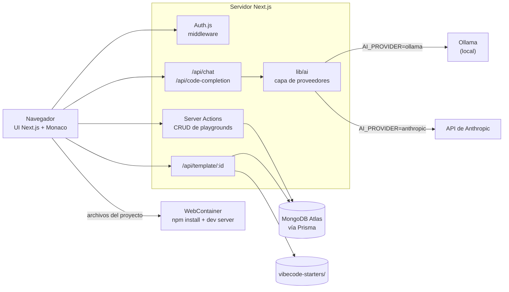

# VibeCode Editor


[English](README.md) · **Español**

Un editor de código en el navegador con asistente de IA. Creas un proyecto a partir de una plantilla, lo editas con Monaco y lo ejecutas directamente en el navegador con WebContainers. No hace falta instalar nada en local para ejecutar el código.

[](https://github.com/rosalesdev928/chat-videcoder/actions/workflows/ci.yml)

## Demo

**[chat-videcoder.vercel.app](https://chat-videcoder.vercel.app)**

> El chat y el autocompletado con IA solo funcionan al ejecutar el proyecto en local con Ollama. En la demo online, los paneles de IA muestran un mensaje que lo explica.

## Qué hace

1. **Inicias sesión con GitHub** (también con Google, si se configuran sus credenciales).
2. **Creas playgrounds** a partir de seis plantillas: React, Next.js, Express, Vue, Hono y Angular. Desde el dashboard puedes renombrarlos, duplicarlos, borrarlos y marcarlos como favoritos.
3. **Editas archivos** con Monaco (el editor de VS Code). El explorador permite crear, renombrar y borrar archivos y carpetas. `Ctrl+S` guarda y los cambios quedan en la base de datos.
4. **Ejecutas el proyecto en el navegador.** Un WebContainer instala las dependencias, arranca el servidor de desarrollo y muestra la vista previa en vivo. La terminal integrada (xterm.js) ejecuta comandos dentro del mismo contenedor.
5. **Le preguntas a la IA.** El panel de chat tiene los modos chat, review, fix y optimize. El autocompletado sugiere código con `Ctrl+Space` o al escribir caracteres como `{`, `.` o un salto de línea; `Tab` acepta y `Esc` descarta.

## Stack

| Área | Tecnología |
|---|---|
| Framework | Next.js 15 (App Router, Server Actions), React 19, TypeScript |
| Estilos | Tailwind CSS, shadcn/ui |
| Autenticación | Auth.js (NextAuth v5) con OAuth de GitHub |
| Base de datos | Prisma + MongoDB Atlas |
| Editor | Monaco Editor |
| Ejecución en el navegador | WebContainers, xterm.js |
| IA | Ollama (local) o API de Anthropic, según variables de entorno |
| Pruebas y CI | Vitest, GitHub Actions |
| Hosting | Vercel |

## Arquitectura



- **Navegador.** La interfaz de Next.js: dashboard, explorador de archivos, editor Monaco, terminal y chat de IA.
- **Auth.js.** Gestiona el OAuth de GitHub. El middleware protege todas las páginas salvo el login, y las sesiones son JWT.
- **Server Actions.** Crean, leen, actualizan y borran playgrounds y sus archivos. Cada acción comprueba que el playground pertenece al usuario con sesión.
- **`/api/template/:id`.** La primera vez que se abre un playground, lee la carpeta de la plantilla en `vibecode-starters/` y la devuelve como JSON. Después se usan los archivos guardados en MongoDB.
- **Prisma + MongoDB Atlas.** Guarda usuarios, cuentas OAuth, playgrounds, sus archivos y los favoritos.
- **WebContainer.** Ejecuta Node.js dentro de la pestaña del navegador: monta los archivos del proyecto, ejecuta `npm install` y arranca el servidor de desarrollo que se ve en la vista previa.
- **Rutas de IA + `lib/ai`.** Los endpoints de chat y autocompletado exigen sesión, aplican un rate limit por usuario y timeouts, y llaman al proveedor elegido con `AI_PROVIDER`: Ollama o Anthropic.

## Estructura del proyecto

```
app/                Rutas de Next.js: páginas, layouts y endpoints de API (chat, autocompletado, plantillas, auth)
modules/            Funcionalidades: auth, dashboard, playground (editor, explorador), ai-chat, webcontainers
lib/                Código compartido: cliente de Prisma, capa de IA, rate limiter, rutas de plantillas
components/         Componentes de UI reutilizables (shadcn/ui) y providers
prisma/             Esquema de la base de datos (schema.prisma)
vibecode-starters/  Plantillas con las que se crean los playgrounds
```

## Mejoras propias sobre la base

- **Proveedor de IA configurable.** `AI_PROVIDER=ollama|anthropic`, con los modelos y las URLs en variables de entorno en lugar de fijos en el código. Usa el SDK oficial de Anthropic y añade timeouts y mensajes de error claros.
- **Rate limiting** por usuario en los endpoints de chat y autocompletado.
- **Control de propietario.** Las acciones sobre playgrounds y el endpoint de plantillas comprueban que el playground es del usuario. Antes, cualquier usuario con sesión podía borrar o sobrescribir el de otro.
- **Corrección de bugs**, entre ellos:
  - aceptar sugerencias de IA no hacía nada;
  - las vistas previas de Vue, Hono y Next.js ejecutaban el script de npm equivocado;
  - el WebContainer nunca se cerraba;
  - el código inline del chat generaba HTML inválido;
  - aparecía "guardado" aunque el guardado fallara.
- **82 pruebas unitarias** con Vitest y un pipeline de **GitHub Actions** que ejecuta lint, typecheck, pruebas y build.
- **Actualización de dependencias:** Next.js y otros paquetes con vulnerabilidades críticas, sin cambios que rompan nada.

## Cómo ejecutarlo en local

### Requisitos

- Node.js 22
- Una base de datos MongoDB (sirve el plan gratis de MongoDB Atlas)
- Una OAuth App de GitHub con la URL de callback `http://localhost:3000/api/auth/callback/github`
- [Ollama](https://ollama.com), para las funciones de IA

### Pasos

```bash
npm install
cp .env.example .env      # y rellena los valores de abajo
npx prisma generate
npx prisma db push
ollama pull codellama
npm run dev
```

Abre <http://localhost:3000>. Ollama tiene que estar en marcha para usar la IA; el resto de la app funciona sin él.

### Variables de entorno

| Variable | Obligatoria | Descripción |
|---|---|---|
| `DATABASE_URL` | Sí | Cadena de conexión de MongoDB |
| `AUTH_SECRET` | Sí | Secreto para firmar las sesiones. Se genera con `npx auth secret` |
| `AUTH_GITHUB_ID` | Sí | Client ID de la OAuth App de GitHub |
| `AUTH_GITHUB_SECRET` | Sí | Client secret de la OAuth App de GitHub |
| `AUTH_GOOGLE_ID` | No | Client ID de OAuth de Google. El botón de Google solo aparece si están las dos variables de Google |
| `AUTH_GOOGLE_SECRET` | No | Client secret de OAuth de Google |
| `AI_PROVIDER` | No | `ollama` (por defecto) o `anthropic` |
| `AI_MODEL` | No | Modelo del chat. Por defecto, `codellama:latest` con Ollama y `claude-opus-5-5` con Anthropic |
| `AI_COMPLETION_MODEL` | No | Modelo del autocompletado. Por defecto, el de `AI_MODEL` |
| `AI_EFFORT` | No | Solo Anthropic: `low`, `medium`, `high`, `xhigh` o `max` |
| `OLLAMA_BASE_URL` | No | URL de Ollama. Por defecto, `http://localhost:11434` |
| `ANTHROPIC_API_KEY` | Solo con `anthropic` | API key de Anthropic |

### Scripts útiles

| Comando | Descripción |
|---|---|
| `npm run dev` | Servidor de desarrollo |
| `npm run lint` | ESLint |
| `npm run typecheck` | Comprobación de TypeScript |
| `npm test` | Pruebas unitarias |
| `npm run build` | Build de producción |

## Despliegue en Vercel

1. Importa el repositorio en Vercel. La configuración por defecto de Next.js funciona: `postinstall` ejecuta `prisma generate`, y los archivos de las plantillas se incluyen en la ruta de API que los lee.
2. En MongoDB Atlas, permite conexiones desde Vercel (Network Access) y ejecuta una vez `npx prisma db push` contra la base de datos de producción.
3. Añade estas variables de entorno en Vercel:
   - `DATABASE_URL`
   - un `AUTH_SECRET` nuevo
   - `AUTH_GITHUB_ID` y `AUTH_GITHUB_SECRET`, de una OAuth App de GitHub con callback `https://<tu-dominio>/api/auth/callback/github`
   - opcionalmente, `AUTH_GOOGLE_ID` y `AUTH_GOOGLE_SECRET`
4. Para tener IA en producción, define `AI_PROVIDER=anthropic` y `ANTHROPIC_API_KEY`. Sin ellas, la app desplegada indica que la IA solo está disponible en local con Ollama.

## Créditos y licencia

Proyecto educativo basado en un curso de desarrollo web con Next.js e IA; plantillas de [Aestheticsuraj234/vibecode-starters](https://github.com/Aestheticsuraj234/vibecode-starters).
