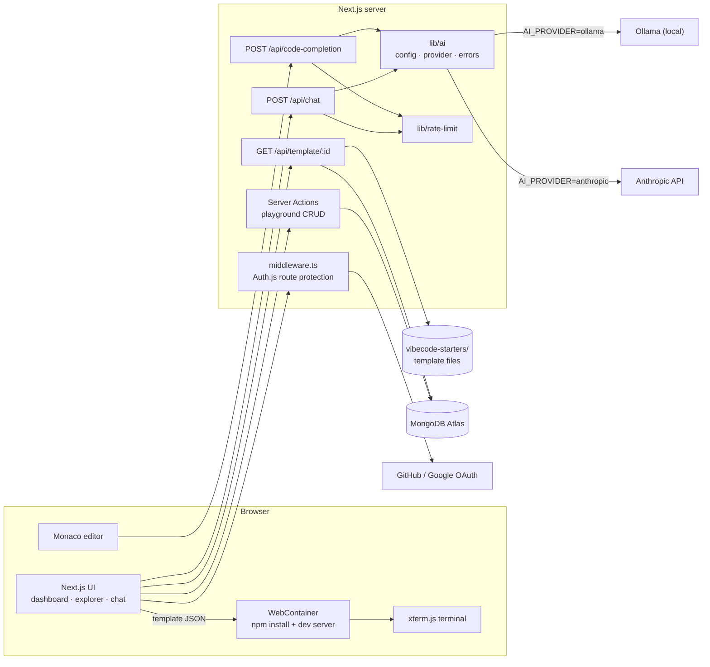

# VibeCode Editor

**English** · [Español](README.es.md)


A web IDE that runs full projects **inside the browser**. Pick a template (React, Next.js, Express, Vue, Hono or Angular), edit it in Monaco, run it with WebContainers, use the integrated terminal, and get help from an AI assistant and inline code completion.

The AI provider is configurable: **Ollama** locally (free, no API key) or the **Anthropic API** (Claude) in production.

## Features

- **OAuth sign-in** with GitHub and Google (Auth.js + Prisma adapter).
- **Dashboard** to create, rename, duplicate, delete and star playgrounds.
- **6 starter templates**: React, Next.js, Express, Vue, Hono and Angular.
- **File explorer**: create, rename and delete files and folders; changes are saved to MongoDB.
- **Monaco editor** with syntax highlighting per language and `Ctrl+S` to save.
- **In-browser runtime** with WebContainers: `npm install` and the dev server run in the browser tab, with a live preview.
- **Terminal** (xterm.js) connected to the WebContainer.
- **AI chat** with chat / review / fix / optimize modes and Markdown + code rendering.
- **AI inline completion**: `Ctrl+Space` (or after typing characters such as `{`, `.`, `=` or a new line); `Tab` accepts, `Esc` dismisses.
- Light/dark theme.

## Tech stack

| Layer | Technology |
|---|---|
| Framework | Next.js 15 (App Router, Server Actions, Route Handlers), React 19, TypeScript |
| UI | Tailwind CSS 4, shadcn/ui (Radix), lucide-react |
| Auth | Auth.js (NextAuth v5) — GitHub & Google OAuth, JWT sessions |
| Database | MongoDB Atlas + Prisma ORM |
| Editor | Monaco Editor (`@monaco-editor/react`) |
| Runtime | WebContainers (`@webcontainer/api`) |
| Terminal | xterm.js |
| AI | Ollama (local) or Anthropic API via `@anthropic-ai/sdk` |
| Quality | ESLint, `tsc`, Vitest, GitHub Actions |

## Architecture



**How a playground runs**

1. The user creates a playground and picks a template. Its metadata is stored in MongoDB.
2. The first time it is opened, `/api/template/[id]` reads the template folder from `vibecode-starters/` and returns it as JSON. After that, the files saved in MongoDB are used.
3. The browser mounts those files in a WebContainer, runs `npm install` and starts the dev server (`dev`, `start` or `serve` script). The preview is an iframe pointing to that server.
4. Every save updates both the WebContainer file system and MongoDB.

**AI requests** go through `lib/ai`: `getAIConfig()` reads the environment, `generateText()` calls Ollama (`/api/chat`) or the Anthropic Messages API, and `classifyAIError()` turns failures into clear HTTP errors (429, 503, 504…). Both AI routes require a session, validate input size, apply a per-user rate limit and use timeouts.

## Getting started

### Requirements

- Node.js 22 (see `.nvmrc`)
- A MongoDB database (MongoDB Atlas free tier works; Prisma requires a replica set, which Atlas provides)
- A GitHub OAuth App and/or a Google OAuth client
- **AI (choose one):** [Ollama](https://ollama.com) installed locally, or an Anthropic API key

### 1. Install

```bash
git clone <your-repo-url>
cd chai-vibe-editor-master
npm install
```

### 2. Environment variables

```bash
cp .env.example .env
```

Fill in the values (see the table below). Generate `AUTH_SECRET` with `npx auth secret` or `openssl rand -base64 32`.

OAuth callback URLs for local development:

- GitHub: `http://localhost:3000/api/auth/callback/github`
- Google: `http://localhost:3000/api/auth/callback/google`

### 3. Database

```bash
npx prisma generate   # generate the Prisma client
npx prisma db push    # create collections and indexes in MongoDB
```

With MongoDB, Prisma uses `db push` instead of `migrate`.

### 4. AI (local, with Ollama)

```bash
ollama pull codellama:latest   # or the model you set in AI_MODEL
```

Ollama must be running (`ollama serve`) for the chat and inline completion. The rest of the app works without it.

### 5. Run

```bash
npm run dev
```

Open <http://localhost:3000>.

## Environment variables

| Variable | Required | Description |
|---|---|---|
| `DATABASE_URL` | Yes | MongoDB connection string |
| `AUTH_SECRET` | Yes | Secret used by Auth.js to sign/encrypt sessions |
| `AUTH_GITHUB_ID` / `AUTH_GITHUB_SECRET` | Yes* | GitHub OAuth App credentials |
| `AUTH_GOOGLE_ID` / `AUTH_GOOGLE_SECRET` | Yes* | Google OAuth client credentials |
| `AI_PROVIDER` | No | `ollama` (default) or `anthropic` |
| `AI_MODEL` | No | Chat model. Default: `codellama:latest` (Ollama) / `claude-opus-5-5` (Anthropic) |
| `AI_COMPLETION_MODEL` | No | Model for inline completion. Defaults to `AI_MODEL` |
| `AI_EFFORT` | No | Anthropic only: `low`, `medium`, `high`, `xhigh` or `max` |
| `OLLAMA_BASE_URL` | No | Default `http://localhost:11434` |
| `ANTHROPIC_API_KEY` | If `AI_PROVIDER=anthropic` | Anthropic API key |

\* Both providers are configured in `auth.config.ts`; configure at least the one you will use.

`.env` is git-ignored. Never commit real secrets; `.env.example` only contains placeholders.

## Scripts

| Command | Description |
|---|---|
| `npm run dev` | Development server (Turbopack) |
| `npm run build` / `npm start` | Production build / server |
| `npm run lint` | ESLint on the whole project |
| `npm run typecheck` | TypeScript type check |
| `npm test` | Unit tests (Vitest) |

CI (`.github/workflows/ci.yml`) runs lint, typecheck, tests and build on every push and pull request.

## Project structure

```
app/                  Next.js routes (pages, layouts, API route handlers)
  api/chat/           AI chat endpoint
  api/code-completion AI inline completion endpoint
  api/template/[id]/  Template files for a playground
lib/                  Shared server code: Prisma client, AI layer, rate limiter
modules/              Features: auth, dashboard, playground, ai-chat, webcontainers
prisma/schema.prisma  Data model (users, accounts, playgrounds, files, stars)
vibecode-starters/    Starter templates (StackBlitz starters, MIT)
```

## Deploying to Vercel

The project is ready for Vercel with no `vercel.json`:

- `postinstall` runs `prisma generate`, so the Prisma client is always rebuilt (Vercel caches `node_modules`).
- `next.config.ts` bundles the six starter folders with `/api/template/[id]` (`outputFileTracingIncludes`), and that route scans them in memory (the serverless file system is read-only).
- The AI routes declare `maxDuration` (120 s chat, 30 s completion) and their own timeouts.
- `engines.node` selects Node.js 22.

Steps:

1. **Database**: in MongoDB Atlas, create a database user and allow connections from Vercel (Network Access → `0.0.0.0/0`, or use the Vercel ↔ Atlas integration). Create the collections once from your machine: `DATABASE_URL="<production url>" npx prisma db push`.
2. **Import** the GitHub repository in Vercel (framework preset: Next.js, default build command).
3. **Environment variables** (Production): `DATABASE_URL`, a new `AUTH_SECRET`, `AUTH_GITHUB_ID`, `AUTH_GITHUB_SECRET`, `AUTH_GOOGLE_ID`, `AUTH_GOOGLE_SECRET`, `AI_PROVIDER=anthropic`, `ANTHROPIC_API_KEY` and, optionally, `AI_MODEL`, `AI_COMPLETION_MODEL` and `AI_EFFORT`. Ollama cannot run on Vercel.
4. **OAuth callbacks** for your production domain:
   - GitHub (an OAuth App accepts a single callback URL, so create a separate app for production): `https://<your-domain>/api/auth/callback/github`
   - Google (add it to the same client): `https://<your-domain>/api/auth/callback/google`, plus `https://<your-domain>` as an authorized JavaScript origin. Publish the OAuth consent screen, or only test users will be able to sign in.
5. **Redeploy** after adding the variables.

On Vercel, Auth.js detects the host automatically (`AUTH_URL` is not needed). On other hosts, set `AUTH_TRUST_HOST=true` or `AUTH_URL`. Preview deployments have different URLs, so OAuth sign-in only works on the domains registered in GitHub and Google.

## Credits and what I added

This project started from the **VibeCode Editor** course project by **[COURSE AUTHOR — fill in]** ([course link — fill in]). The base application (UI, authentication, dashboard, Monaco editor, WebContainers, terminal and the Ollama-based AI chat and completion) comes from that course.

The starter templates in `vibecode-starters/` come from [StackBlitz Starters](https://github.com/stackblitz/starters) (MIT License).

**What I added on top of the course project:**

- **Configurable AI provider**: `AI_PROVIDER=ollama|anthropic` with models from environment variables (no hardcoded models or URLs), using the official Anthropic SDK in production.
- **Reliability on the AI routes**: timeouts, retries, mapping errors to clear HTTP responses, input size limits and a per-user rate limit.
- **Security fixes**: Server Actions and `/api/template` now check the session and that the playground belongs to the user (before, any signed-in user could delete or overwrite another user's playground). Internal helpers that returned OAuth tokens were moved out of a `"use server"` file.
- **Bug fixes**: accepting AI suggestions did nothing, the Vue/Hono/Next.js previews ran the wrong npm script, the WebContainer was never torn down, a `TypeError` on editor unmount, Markdown inline code caused invalid HTML (hydration error), success toasts shown on failed saves, invalid Monaco options, and more.
- **Code quality**: from 4 TypeScript errors and 96 ESLint problems to zero; ESLint now covers the whole project.
- **Tests and CI**: 79 unit tests with Vitest for `lib/` and `modules/playground/lib`, and a GitHub Actions pipeline (lint, typecheck, test, build).
- **Vercel deployment**: template files bundled with the serverless function, no writes to the file system, `prisma generate` on install, and image optimization restricted to OAuth avatar hosts (it allowed any host).
- Bilingual documentation (English / Spanish).

## Known limitations

- The rate limiter is in memory: with several server instances each one counts separately. A shared store (e.g. Redis) would be needed for a strict global limit.
- Saving a file matches it by name and extension, so two files with the same name in different folders (e.g. two `index.ts`) can overwrite each other.
- WebContainers work best in Chromium-based browsers (Chrome, Edge); support in other browsers is limited. They need cross-origin isolation, which the app enables with COOP/COEP headers in `next.config.ts`.
