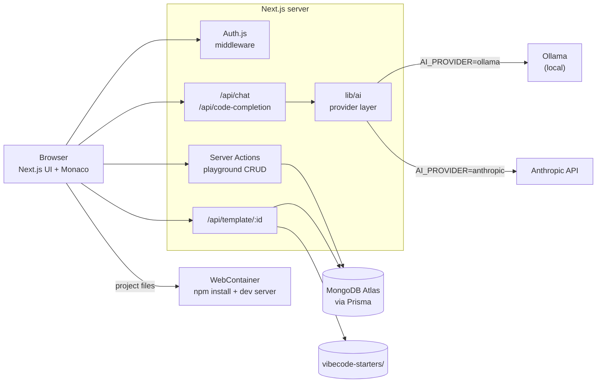

# VibeCode Editor


**English** · [Español](README.es.md)

An in-browser code editor with an AI assistant. Create a project from a template, edit it with Monaco, and run it directly in the browser with WebContainers. No local setup is needed to run the code.

[](https://github.com/rosalesdev928/chat-videcoder/actions/workflows/ci.yml)

## Demo

**[chat-videcoder.vercel.app](https://chat-videcoder.vercel.app)**

> The AI chat and code completion only work when running the project locally with Ollama. In the online demo, the AI panels show a message explaining this.

## What it does

1. **Sign in with GitHub** (Google sign-in is also available when its credentials are configured).
2. **Create playgrounds** from six templates: React, Next.js, Express, Vue, Hono and Angular. From the dashboard you can rename, duplicate, delete and star them.
3. **Edit files** in the Monaco editor (the editor used by VS Code). A file explorer lets you create, rename and delete files and folders. `Ctrl+S` saves; changes are stored in the database.
4. **Run the project in the browser.** A WebContainer installs the dependencies, starts the dev server and shows a live preview. An integrated terminal (xterm.js) runs commands inside the same container.
5. **Ask the AI.** A chat panel has chat, review, fix and optimize modes. Inline completion suggests code with `Ctrl+Space` or after typing characters such as `{`, `.` or a new line; `Tab` accepts and `Esc` dismisses.

## Tech stack

| Area | Technology |
|---|---|
| Framework | Next.js 15 (App Router, Server Actions), React 19, TypeScript |
| Styling | Tailwind CSS, shadcn/ui |
| Authentication | Auth.js (NextAuth v5) with GitHub OAuth |
| Database | Prisma + MongoDB Atlas |
| Editor | Monaco Editor |
| In-browser runtime | WebContainers, xterm.js |
| AI | Ollama (local) or Anthropic API, selected with environment variables |
| Testing and CI | Vitest, GitHub Actions |
| Hosting | Vercel |

## Architecture



- **Browser.** The Next.js interface: dashboard, file explorer, Monaco editor, terminal and AI chat.
- **Auth.js.** Handles GitHub OAuth. The middleware protects every page except sign-in, and sessions are JWTs.
- **Server Actions.** Create, read, update and delete playgrounds and their files. Every action checks that the playground belongs to the signed-in user.
- **`/api/template/:id`.** The first time a playground is opened, it reads the template folder from `vibecode-starters/` and returns it as JSON. After that, the files saved in MongoDB are used.
- **Prisma + MongoDB Atlas.** Stores users, OAuth accounts, playgrounds, their files and stars.
- **WebContainer.** Runs Node.js inside the browser tab: it mounts the project files, runs `npm install` and starts the dev server shown in the preview.
- **AI routes + `lib/ai`.** The chat and completion endpoints require a session, apply a per-user rate limit and timeouts, and call the provider chosen with `AI_PROVIDER`: Ollama or Anthropic.

## Project structure

```
app/                Next.js routes: pages, layouts and API endpoints (chat, completion, templates, auth)
modules/            Features: auth, dashboard, playground (editor, explorer), ai-chat, webcontainers
lib/                Shared code: Prisma client, AI provider layer, rate limiter, template paths
components/         Reusable UI components (shadcn/ui) and providers
prisma/             Database schema (schema.prisma)
vibecode-starters/  Starter templates used to create new playgrounds
```

## Improvements over the base project

- **Configurable AI provider.** `AI_PROVIDER=ollama|anthropic`, with models and URLs taken from environment variables instead of being hardcoded. It uses the official Anthropic SDK and adds timeouts and clear error messages.
- **Rate limiting** per user on the chat and completion endpoints.
- **Ownership checks.** Playground actions and the template endpoint verify that the playground belongs to the user. Before, any signed-in user could delete or overwrite another user's playground.
- **Bug fixes**, among them:
  - accepting AI suggestions did nothing;
  - the Vue, Hono and Next.js previews ran the wrong npm script;
  - the WebContainer was never shut down;
  - inline code in chat produced invalid HTML;
  - success messages appeared even when a save failed.
- **82 unit tests** with Vitest, plus a **GitHub Actions** pipeline that runs lint, typecheck, tests and build.
- **Dependency updates:** Next.js and other packages with critical vulnerabilities, without breaking changes.

## Running locally

### Requirements

- Node.js 22
- A MongoDB database (the MongoDB Atlas free tier works)
- A GitHub OAuth App with the callback URL `http://localhost:3000/api/auth/callback/github`
- [Ollama](https://ollama.com), for the AI features

### Steps

```bash
npm install
cp .env.example .env      # then fill in the values below
npx prisma generate
npx prisma db push
ollama pull codellama
npm run dev
```

Open <http://localhost:3000>. Ollama must be running for the AI features; the rest of the app works without it.

### Environment variables

| Variable | Required | Description |
|---|---|---|
| `DATABASE_URL` | Yes | MongoDB connection string |
| `AUTH_SECRET` | Yes | Secret used to sign sessions. Generate it with `npx auth secret` |
| `AUTH_GITHUB_ID` | Yes | GitHub OAuth App client ID |
| `AUTH_GITHUB_SECRET` | Yes | GitHub OAuth App client secret |
| `AUTH_GOOGLE_ID` | No | Google OAuth client ID. The Google button only appears if both Google variables are set |
| `AUTH_GOOGLE_SECRET` | No | Google OAuth client secret |
| `AI_PROVIDER` | No | `ollama` (default) or `anthropic` |
| `AI_MODEL` | No | Chat model. Default: `codellama:latest` for Ollama, `claude-opus-5-5` for Anthropic |
| `AI_COMPLETION_MODEL` | No | Model for inline completion. Defaults to `AI_MODEL` |
| `AI_EFFORT` | No | Anthropic only: `low`, `medium`, `high`, `xhigh` or `max` |
| `OLLAMA_BASE_URL` | No | Ollama URL. Default: `http://localhost:11434` |
| `ANTHROPIC_API_KEY` | Only with `anthropic` | Anthropic API key |

### Useful scripts

| Command | Description |
|---|---|
| `npm run dev` | Development server |
| `npm run lint` | ESLint |
| `npm run typecheck` | TypeScript check |
| `npm test` | Unit tests |
| `npm run build` | Production build |

## Deploying to Vercel

1. Import the repository in Vercel. The default Next.js settings work: `postinstall` runs `prisma generate`, and the template files are bundled with the API route that reads them.
2. In MongoDB Atlas, allow connections from Vercel (Network Access) and run `npx prisma db push` once against the production database.
3. Add these environment variables in Vercel:
   - `DATABASE_URL`
   - a new `AUTH_SECRET`
   - `AUTH_GITHUB_ID` and `AUTH_GITHUB_SECRET`, from a GitHub OAuth App whose callback is `https://<your-domain>/api/auth/callback/github`
   - optionally, `AUTH_GOOGLE_ID` and `AUTH_GOOGLE_SECRET`
4. For AI in production, set `AI_PROVIDER=anthropic` and `ANTHROPIC_API_KEY`. Without them, the deployed app shows that the AI is only available locally with Ollama.

## Credits and license

Educational project based on a web development course with Next.js and AI; templates from [Aestheticsuraj234/vibecode-starters](https://github.com/Aestheticsuraj234/vibecode-starters).
